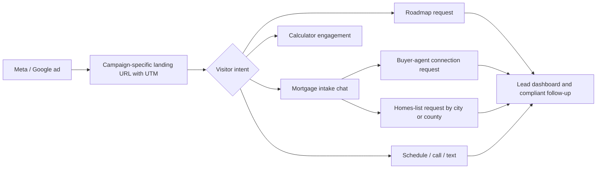

# First-Time Homebuyer Buyer-Attraction Campaign Kit

> **Draft for company compliance and qualified legal review before launch.** This is a working campaign plan, not legal advice or a guarantee of platform approval, consumer eligibility, conversion volume, or loan terms.

## 1. Campaign purpose

The campaign should bring Oregon first-time buyers to **[firsttimehomebuyer.manus.space](https://firsttimehomebuyer.manus.space)**, then help them choose an appropriate next step: request the Roadmap, complete the mortgage-intake chat, request buyer-agent connection, request homes-for-sale information, schedule a strategy call, or start a secure application. The website already provides educational calculators, Roadmap capture, SMS consent, mortgage chat, Calendly, direct contact options, and a secure application path.[4]

The campaign should attract people looking for first-home financing information without implying that any person, property, interest rate, payment, down payment, assistance amount, or approval is guaranteed. Every rate, payment, down-payment, buydown, and program assertion must pass company compliance review before publication.[1] [2]

| Objective | Primary visitor action | Recommended campaign optimization event | Why it matters |
|---|---|---|---|
| Lead education | Submit the Roadmap form | `roadmap_request_submit` | Captures a clear request for first-time buyer education. |
| Qualified financing conversation | Complete the mortgage-intake chat | `chat_intake_complete` | Captures a higher-intent discussion without making an approval claim. |
| Buyer-agent help | Request a buyer-agent connection in chat | `buyer_agent_connection_request` | Creates a clear handoff opportunity when the prospect requests representation. |
| Home-search assistance | Request homes-for-sale information by city or county | `homes_list_request` | Connects property-search intent to an appropriate follow-up workflow. |
| Human conversation | Book a call or tap to call | `strategy_call_booking` / `phone_call_click` | Measures direct consultation interest. |

## 2. Non-negotiable compliance guardrails

Mortgage advertising requires a review process before any platform launch. Regulation Z requires advertised credit terms to be actually available, requires required disclosures to be clear and conspicuous, and can require additional disclosures when ads state triggering terms such as down-payment amounts, payment amounts, payment periods, or finance charges.[1] Oregon’s Division of Financial Regulation separately identifies note-rate-without-APR and trigger-term-without-required-disclosure advertising as common mortgage-advertising violations.[2]

Use the following operating rules for every paid ad, landing-page variant, video, graphic, and lead-form question.

| Required control | Implementation standard |
|---|---|
| **Pre-publication approval** | Company compliance or qualified counsel approves final ad text, image/video, landing page, disclosure placement, audience settings, and UTM destination before launch. |
| **NMLS and company disclosure** | Include the loan officer’s NMLS ID, business identity, licensing statement, and any company-required information in the creative or destination context required by company policy. Confirm the exact approved disclosure block with Cornerstone compliance. |
| **No unverified terms** | Do not publish a numerical rate, APR, payment, down payment, buydown saving, cash-to-close amount, DPA amount, or qualification standard until compliance validates the specific claim, timing, APR, disclosure sequence, and availability. |
| **Program language** | Use phrases such as “explore potential low- and zero-down paths, subject to program and borrower eligibility” rather than “you qualify,” “guaranteed,” or “no money needed.” OHCS Flex Lending may pair with DPA, but eligibility and program terms must be verified case by case.[3] |
| **Fair-lending-safe copy** | Speak to the opportunity and the educational resource, never to an assumed personal attribute or protected class. Avoid phrases such as “Are you a renter?”, “bad credit?”, “newly married?”, “families with children,” or “perfect for veterans” in targeting or ad language. |
| **Data minimization** | Do not put financial, credit, health, protected-class, or application data into ad URLs, UTM parameters, pixels, conversion APIs, or audience lists. Keep chat and Roadmap submission data within the secured application/dashboard workflow. |
| **Consent alignment** | Keep the Roadmap phone and SMS-consent language subject to counsel review before using phone/SMS data for follow-up or uploaded audience features. Do not upload leads to customer-match/remarketing products until legal/compliance approves the policy, consent, and data handling. |

## 3. Funnel design

The page has several excellent conversion paths. The ad system should not optimize only for clicks. It should first measure real lead actions, then optimize gradually toward completed Roadmap requests and completed chats.

### Landing-page route strategy

| Ad family | Destination | Primary call to action | Ad-to-page message match |
|---|---|---|---|
| Roadmap education | `https://firsttimehomebuyer.manus.space/?utm_source=...#roadmap` | **Get the free Roadmap** | “Understand the first-home process before you start searching.” |
| Monthly-payment clarity | `https://firsttimehomebuyer.manus.space/?utm_source=...#book-call` | **See what your numbers look like** | “Compare renting, buying, and payment scenarios as educational estimates.” |
| Program exploration | `https://firsttimehomebuyer.manus.space/?utm_source=...#programs` | **Find your best program** | “Explore potential USDA, VA, conventional, FHA, and approved state-program paths.” |
| Strategy call | `https://firsttimehomebuyer.manus.space/?utm_source=...#book-call` | **Book a 15-min Call** | “Talk through timing, budget, and next steps—without a pressure pitch.” |
| Chat engagement | `https://firsttimehomebuyer.manus.space/?utm_source=...` | **Ask about buying** | “Get your first-home questions organized before a mortgage conversation.” |

## 4. Meta campaign plan

Meta treats U.S. financial-products-and-services campaigns as a Special Ad Category. It restricts several audience controls, including ZIP/postal-code targeting, gender targeting, some interests, exclusions, and lookalikes. Specific U.S. city/address targeting carries an expanded 15-mile radius.[5]

### Recommended starting structure

| Campaign | Objective | Geographic strategy | Creative mix | Optimization phase |
|---|---|---|---|---|
| **META-ORE-FTHB-Roadmap** | Website leads | Oregon statewide or approved city/region audiences; no ZIP targeting | Static education card, short vertical video, carousel explaining the Roadmap | Landing-page views first; move to Roadmap submissions only after reliable tracking and enough conversion volume. |
| **META-ORE-FTHB-Chat** | Website leads | Same approved geography; no prohibited exclusions | “Ask about buying” education creative; calculator walkthrough | Mortgage-chat completion, if the event is configured and compliance-approved. |
| **META-ORE-FTHB-Call** | Website leads or traffic | Same approved geography | Mike’s advisor-led introduction and 15-minute strategy-call creative | Calendly booking or qualified call click. |

### Meta creative concepts for compliance review

#### Concept A — Roadmap education

**Primary text:** “Buying your first home can feel complicated before you know the steps. Get a free First-Time Homebuyer Roadmap and explore how pre-approval, down payment options, and planning fit together.”

**Headline:** “Get the free First-Time Homebuyer Roadmap”

**Description:** “Educational guidance. Loan options and eligibility vary.”

**CTA:** “Learn More” or “Sign Up”

#### Concept B — Start with clarity

**Primary text:** “Before you start touring homes, get a clear picture of your budget, timeline, and potential financing paths. Explore first-home education and request a no-pressure strategy conversation.”

**Headline:** “Plan your first home with clarity”

**Description:** “Explore options with a local Oregon loan officer.”

**CTA:** “Learn More”

#### Concept C — Home-search readiness

**Primary text:** “Want help getting ready to shop for your first home? Start with the Roadmap, ask questions in the mortgage chat, and request a buyer-agent connection or homes-for-sale guidance when you are ready.”

**Headline:** “Start your first-home plan”

**Description:** “Resources and financing guidance for Oregon buyers.”

**CTA:** “Get Started”

### Meta creative production brief

Use the approved Cornerstone logo, Mike Ford headshot, current NMLS/identity block, the existing warm home imagery, and screen captures of the Roadmap/calculator experience. The creative should be educational and inclusive, avoiding images or text that imply a preferred buyer demographic. Every image/video must be reviewed with the same disclosure checklist as text.

## 5. Google Ads and Maps/local visibility plan

Google categorizes consumer finance and housing as “access to opportunities” categories in the United States and Canada. Do not target by age, gender, parental status, marital status, or ZIP code. City, country, and radius targeting remain supported.[6]

### Search campaign structure

| Campaign | Ad groups | Buyer-intent keyword themes | Landing-page section | Primary conversion |
|---|---|---|---|---|
| **GOOG-ORE-FTHB-Guide** | First-time buyer guide; Homebuyer roadmap; Pre-approval basics | “oregon first time home buyer guide,” “first time homebuyer roadmap,” “how to get preapproved in oregon” | Roadmap | Roadmap request |
| **GOOG-ORE-FTHB-Programs** | Low down payment; USDA home loan; FHA first home; VA first home | “oregon low down payment home loan,” “usda home loan oregon,” “fha first time homebuyer oregon” | Programs | Chat completion or Roadmap request |
| **GOOG-ORE-FTHB-Advisor** | Loan officer; Mortgage advisor; Strategy call | “first time homebuyer loan officer oregon,” “mortgage advisor lake oswego,” “first home mortgage help oregon” | Strategy call | Booked call / call click |
| **GOOG-ORE-FTHB-Local** | City-neutral local service queries | “first time homebuyer help coos bay,” “first home mortgage medford,” “mortgage advisor salem oregon” | Roadmap or strategy call | Roadmap request |

Use exact and phrase match first, protect the budget with negative-keyword review, and add broad match only after conversion data supports it. Suggested initial negatives include **jobs**, **careers**, **servicing**, **login**, **rent payment**, **rent assistance**, **free government money**, **foreclosure help**, and unrelated lender/brand searches. The final negative list must be reviewed against actual search-term data rather than treated as static.

### Responsive search-ad drafts for compliance review

| Asset type | Draft options |
|---|---|
| Headlines | “First-Time Homebuyer Roadmap”; “Plan Your First Home With Clarity”; “Explore Oregon Homebuying Options”; “Talk With a Local Loan Officer”; “Understand Pre-Approval Steps”; “Explore Low-Down-Payment Paths”; “Request Your Free Roadmap”; “Plan Before You Start Touring Homes” |
| Descriptions | “Get clear on homebuying steps, financing paths, and what to prepare before you begin searching. Eligibility and loan terms vary.”  “Explore first-home resources, educational payment tools, and a no-pressure strategy conversation with an Oregon loan officer.” |
| Callouts | “First-time buyer education”; “15-minute strategy call”; “Oregon licensed”; “Educational estimates”; “Programs vary by eligibility” |
| Structured snippets | “Services: Roadmap, Pre-approval guidance, Homebuyer education, Payment scenarios” |

### Google Maps/local placement

“Google Maps ads” are not a standalone Maps-only campaign. Google says Maps can be a serving surface for eligible Demand Gen, Performance Max, Smart Search, and Search campaigns with location assets; ads cannot be restricted to Google Maps alone.[7] A useful local-presence setup requires an accurate, verified Google Business Profile and linked location assets. Location assets can surface the address, map, phone/directions, and may appear across Google Search, Maps, Display, and YouTube when eligible.[8]

Start with **Search + location assets** only. Consider Performance Max or Demand Gen after conversion tracking has been validated and compliance approves the creative formats. Do not treat Maps impressions or direction clicks as proof of loan intent; report them separately from Roadmap and chat completions.

## 6. Measurement and attribution plan

Google allows website conversions through a Google tag, Google Tag Manager, or imported Analytics events; it distinguishes primary (biddable) from secondary (observation) conversions.[9] Use event-level tracking without sending form answers, financial details, or other sensitive data to advertising platforms.

| Event | Category | Initial role | Trigger | Data that must not leave the site |
|---|---|---|---|---|
| `roadmap_request_submit` | Lead | **Primary** after QA | Roadmap form successfully submits | Name, email, phone, consent record, calculator inputs |
| `chat_intake_complete` | Lead | **Primary** after QA | Chat intake successfully completes | Full chat transcript, income, credit, property, phone, email |
| `buyer_agent_connection_request` | Qualified lead | Secondary | Chat answer/request indicates agent connection | Full chat answers and lead identity |
| `homes_list_request` | Qualified lead | Secondary | Chat answer/request asks for homes list by city/county | City/county response paired with lead identity |
| `strategy_call_booking` | Contact | Secondary then evaluate | Calendly confirmation, if reliable | Booking details and any calendar data |
| `calculator_engagement` | Engagement | Secondary | Meaningful calculator completion | Input values, household data |
| `apply_online_click` | High intent | Secondary | Secure application link click | No application data |

### UTM convention

Use a consistent naming pattern so the dashboard and analytics can attribute source without exposing personal data.

| Field | Format | Example |
|---|---|---|
| `utm_source` | Platform | `google`, `meta` |
| `utm_medium` | Paid channel | `cpc`, `paid_social` |
| `utm_campaign` | Platform + geography + goal + version | `goog_ore_fthb_roadmap_v1` |
| `utm_content` | Creative or asset identifier | `roadmap_static_home_v1` |
| `utm_term` | Google keyword theme only; never lead data | `first_time_homebuyer_guide` |

## 7. SEO plan that supports paid media

Paid search gives immediate visibility; SEO should build durable, accurate educational entry points that point into the same Roadmap/chat funnel. Avoid thin city pages, copied program claims, or pages that promise approval. Favor strong Oregon educational pages with reviewed program caveats.

| Priority | Content asset | Intent | Required review note |
|---|---|---|---|
| 1 | “First-Time Homebuyer Roadmap for Oregon Buyers” | Broad educational search | Program availability, licensing, and eligibility language. |
| 2 | “OHCS Flex Lending and Down Payment Assistance: What Oregon Buyers Should Ask” | Program research | Confirm current program facts and approved-lender status immediately before publishing. |
| 3 | “USDA Rural Development Home Loans in Oregon: Location and Eligibility Questions” | USDA research | Do not map eligibility as a promise; direct buyers to case-by-case review. |
| 4 | “How a 2-1 Buydown Works for a Home Purchase” | Payment-planning research | Include full approved disclosure package for any example terms. |
| 5 | “What Happens Before a First-Time Buyer Starts Touring Homes?” | Pre-approval education | Keep it educational and route to Roadmap/chat. |

Technical SEO priorities are a correct title and meta description per page, descriptive headings, accessible image alt text, canonical URLs, fast mobile rendering, structured internal links to Roadmap/programs/FAQ, and clean UTM handling. Maintain the existing NMLS and Equal Housing presentation and have compliance approve any revised claims.

## 8. User-controlled publishing workflow

| Stage | What I prepare | What you control | Approval gate |
|---|---|---|---|
| 1. Campaign kit | Copy, creative briefs, keywords, placement plan, UTM sheet, conversion map, disclosure checklist | Brand direction and business objective | You approve the working draft. |
| 2. Compliance review | Final asset inventory and compliance checklist | Submission to Cornerstone compliance/counsel | Written approval of each asset and landing-page version. |
| 3. Account setup | Step-by-step build sheet for Meta and Google | Account ownership, user access, Business Profile, payment method, budget, and billing | You verify account configuration. |
| 4. Controlled collaboration | Account analysis and recommended changes after connector authorization | Any account connection, audience settings, and proposed edits | You review every potentially billable change. |
| 5. Publish | Final campaign review page | The actual Publish action, spend cap, and ongoing budget | Explicit confirmation in this chat before any platform-side publishing action. |
| 6. Optimization | Weekly performance summary and change recommendations | Adoption of recommended changes | You approve budget, bid, targeting, or creative changes. |

### Account-access status

The current session has catalog entries for **Google Ads** and **Meta Ads Manager**, but neither is connected. I can create and refine the campaign kit without them. When you want account-level analysis, you can authorize the relevant connector; we will then verify its available actions before assuming it can create or edit campaigns. No connector will be enabled, no data will be read, and no platform action will be taken unless you choose to connect it.

## 9. Required launch inputs and review checklist

Before the first campaign is built in either platform, collect these items:

1. Written compliance approval for each ad, image/video, disclosure block, landing page, and conversion definition.
2. Approved company/legal disclosure language, company NMLS information, and any state-specific rules that Cornerstone requires.
3. Meta Business and Google Ads account ownership confirmation, approved user roles, and confirmed billing owner.
4. Verified Google Business Profile, if Google Maps/local visibility is in scope.
5. A starting daily or monthly test budget that **you** set directly in the platform.
6. A defined Oregon geography at city/region/radius level that respects the special-category restrictions.
7. A decision on whether the initial optimization event is Roadmap submission, chat completion, or strategy-call booking.
8. Written approval for analytics/tag configuration, cookie/privacy notice treatment, and any future use of remarketing or customer lists.

## 10. Recommended first-launch sequence

Start with a small, controlled test: one Meta Roadmap campaign and one Google Search Roadmap campaign, both using the same approved educational positioning. Confirm that UTM values arrive in the lead dashboard, Roadmap submissions are measured accurately, the mortgage chat is working, and no sensitive form values are sent to advertising platforms. Only then add the chat-focused campaign, local/Maps assets, broader keyword themes, or additional creative formats.

## References

[1] [CFPB, 12 CFR §1026.24 — Advertising](https://www.consumerfinance.gov/rules-policy/regulations/1026/24)

[2] [Oregon Division of Financial Regulation — Mortgage Industry](https://dfr.oregon.gov/business/licensing/financial/mortgage/pages/index.aspx)

[3] [Oregon Housing and Community Services — Flex Lending](https://www.oregon.gov/ohcs/homeownership/homebuyers/pages/flex-lending.aspx)

[4] [First-Time Homebuyer landing page](https://firsttimehomebuyer.manus.space)

[5] [Meta Business Help — Audiences for housing, employment, or financial products and services campaigns](https://www.facebook.com/business/help/2220749868045706)

[6] [Google Ads — Restricted targeting in Personalized advertising](https://support.google.com/adspolicy/answer/143465?hl=en)

[7] [Google Ads — Show local search ads on Google Maps](https://support.google.com/google-ads/answer/7040605?hl=en)

[8] [Google Ads — About location assets](https://support.google.com/google-ads/answer/2404182?hl=en)

[9] [Google Ads — Set up web conversions](https://support.google.com/google-ads/answer/16560108?hl=en)
